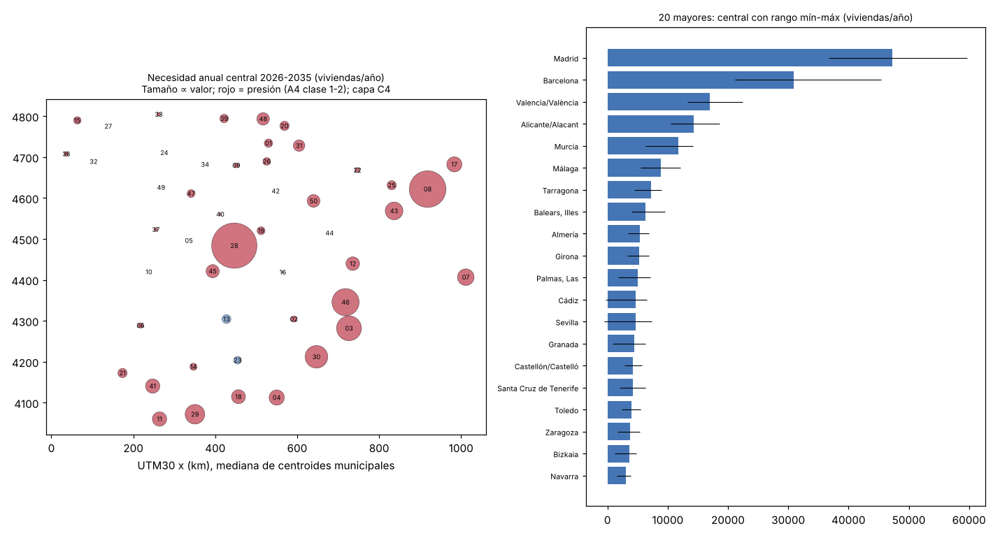
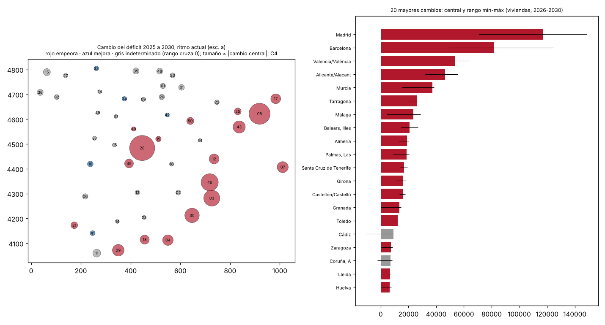

# Necesidades de vivienda por provincia en España, 2026-2035: una contabilidad por componentes con rangos y con la vivienda que liberará el envejecimiento

**Borja Romero, economista.** Borrador de artículo (v5). Todas las cifras proceden de `output/v5/cifras_clave.csv`; cada afirmación lleva su capa de evidencia entre corchetes.

## Resumen

Este artículo estima cuántas viviendas harán falta al año en cada una de las provincias españolas entre 2026 y 2035 mediante una contabilidad stock-flujo por componentes: atraso acumulado, reposición del parque, vacancia friccional y crecimiento de hogares, menos las viviendas vacías movilizables y la cartera en construcción. Cada componente se presenta con un mínimo, un valor central y un máximo, y la capa del total es la menor de sus componentes. La necesidad base agregada (`v5.1`) es de 210.424 viviendas/año (99.388-292.083 viviendas/año) [C4], entre 1,4 veces y 3,8 veces la producción actual; si una parte de las viviendas liberadas no llega al mercado, sube a 245.989 viviendas/año (123.936-338.663 viviendas/año) [C4]. El supuesto que más pesa en el rango es la fracción de vacías movilizables. Todo ello con un crecimiento de hogares proyectado por el INE de 1.720.537 hogares (1.308.531-1.772.410 hogares) en diez años [C2]. El artículo cuantifica además las viviendas que quedarán disponibles por la disolución de hogares de personas mayores, 1.856.430 viviendas (936.056-3.168.590 viviendas) en 2026-2035 [C4], y argumenta por qué esa cifra no debe restarse: la proyección de hogares del INE ya descuenta las disoluciones de hogares, y restarla de nuevo contaría dos veces el mismo fenómeno. Una proyección complementaria indica que de 2025 a 2030 el déficit nacional empeora en todos los escenarios considerados [C2]; la magnitud es [C4] y, por provincias, empeora en 15 provincias, mejora en 0 provincias y en 37 provincias el signo depende de los supuestos [C4]. A 2035 la dirección es indeterminada [C4]. Los resultados son una contabilidad con supuestos explícitos, no un pronóstico ni una estimación de efectos.

**Palabras clave:** necesidad de vivienda, proyección de hogares, envejecimiento, provincias, identificación parcial.

## Abstract

This paper estimates annual housing needs for each Spanish province over 2026-2035 using a component-based stock-flow accounting framework: accumulated backlog, replacement of the stock, frictional vacancy and household growth, net of mobilisable vacant dwellings and the construction pipeline. Each component is reported as a minimum, central and maximum value, and the evidence layer of the total is the weakest of its components. The baseline aggregate need (`v5.1`) is 210.424 viviendas/año (99.388-292.083 viviendas/año) [C4], between 1,4 veces and 3,8 veces current output; if part of the released dwellings does not reach the market, it rises to 245.989 viviendas/año (123.936-338.663 viviendas/año) [C4]. The assumption that weighs most is the share of mobilisable vacant dwellings. All this comes with official household growth of 1.720.537 hogares (1.308.531-1.772.410 hogares) over ten years [C2]. We also quantify the dwellings that will be released by the dissolution of elderly households, 1.856.430 viviendas (936.056-3.168.590 viviendas) in 2026-2035 [C4], and show why this figure must not be subtracted: the official household projection already nets out household dissolutions, so subtracting it again would double count the same flow. A complementary projection shows that between 2025 and 2030 the national backlog worsens in every scenario considered [C2]; its size is [C4] and, by province, it worsens in 15 provincias, improves in 0 provincias and is undetermined in 37 provincias [C4]. By 2035 the direction is undetermined [C4]. Results are accounting under explicit assumptions, not forecasts or identified estimates.

**Keywords:** housing need, household projections, ageing, provinces, partial identification.

## Introducción

La pregunta «cuántas viviendas hacen falta» aparece en el debate público con cifras muy distintas. Parte de la dispersión procede de que se mezclan conceptos: el déficit acumulado (un stock), el crecimiento de hogares (un flujo), las viviendas vacías (un stock cuya movilización es incierta) y la reposición del parque (un flujo difícil de medir). Otra parte procede de que las cifras se presentan como puntos y no como rangos, y de que rara vez se dice qué componente descansa en una sola fuente.

Este artículo ofrece una contabilidad explícita, provincia a provincia, con tres propiedades. Primera, cada componente se calcula por separado y se publica con su rango, de modo que el lector puede sustituir cualquier supuesto. Segunda, la capa de evidencia del total es la menor de las capas de sus componentes, lo que impide que una cifra robusta (el crecimiento de hogares del INE, [C2]) preste su solidez a componentes de fuente única. Tercera, se incorpora de forma explícita la vivienda que liberará el envejecimiento, un flujo grande que suele invocarse como solución y cuya relación con la proyección de hogares rara vez se aclara.

La contribución principal es doble. Por un lado, una tabla provincial de necesidades 2026-2035 con rangos y con control de que la suma provincial coincide con el total nacional (`output/v5/B1/control_sumas.json`). Por otro, la demostración contable de que la vivienda liberada por envejecimiento ya está descontada en la proyección oficial de hogares, con lo que restarla otra vez infravalora la necesidad.

El artículo se organiza así: la sección de datos describe las fuentes y sus fechas; la de método, la fórmula y la construcción de cada rango; la de resultados presenta el agregado, la distribución provincial y la proyección a 2030; la de robustez muestra las variantes; la discusión trata la vivienda liberada y los límites; la conclusión resume lo que se puede y lo que no se puede afirmar.

## Datos

Las fuentes son públicas y se descargan con fecha de consulta registrada (`output/v5/B1/registro.csv`):

- **Hogares.** INE, Proyección de Hogares (base 1 de enero de 2026), por provincia. Es el único componente con dos fuentes comparables en el periodo base y por eso alcanza la capa [C2].
- **Población y mortalidad.** INE, Proyecciones de Población 2024-2074 (corto plazo) y tablas de mortalidad provinciales de 2024, usadas para el componente de envejecimiento.
- **Parque y viviendas vacías.** Censo de Población y Viviendas 2021 (1 de noviembre de 2021): viviendas totales, principales, vacías y de uso esporádico, y viviendas en alquiler.
- **Construcción.** MIVAU, viviendas iniciadas y terminadas (libres y protegidas) hasta 2025.
- **Bajas del parque.** Censo 2011-2021 y Catastro (estadísticas urbanas, ejercicios 2012-2025), cada uno combinado con las terminadas del MIVAU.
- **Déficit de partida.** Módulo A4 del proyecto (déficit 2021-2025 por provincia, con bajas nulas) y clasificación de presión de las provincias.

El déficit agregado de partida se apoya en el aumento de hogares de 2021-2025, 997.586 hogares (981.823-1.013.350 hogares) (2021-2025; INE ECP y EPA (sin corrección: los dos extremos son posteriores a la ruptura de 2021; ventanas distintas: stock a 1 de enero en la ECP y media anual en la EPA, v7.1 K4b-dh); dato de 2025T1; C1), y en la conciliación de v4 entre las cifras de distintos organismos. Los componentes de hogares compartidos, hacinamiento y habitaciones compartidas no tienen dato provincial accesible y quedan fuera; el rango es, por tanto, incompleto por arriba.

## Método

### La identidad contable

La necesidad acumulada en diez años de cada provincia se define como

N = A + R + V + F − M − K,

donde A es el atraso (déficit acumulado 2021-2025 más emancipación retrasada), R la reposición del parque, V el ajuste de vacancia friccional, F el crecimiento de hogares proyectado, M las viviendas vacías movilizables en zonas con presión y K la cartera en construcción. La vivienda liberada por envejecimiento, L, se calcula aparte y **no se resta** en la especificación principal (véase la discusión). El documento de método completo está en `output/v5/B1/metodo.md`.

### Construcción de cada componente

- **Atraso (A).** Suma del déficit 2021-2025 del módulo A4 (A1, 788.154 viviendas (643.007-967.740 viviendas) en el conjunto de provincias) y de la emancipación retrasada respecto a la tasa de jefatura de referencia (A2, 315.017 viviendas (187.956-505.902 viviendas)) [C4]. Se absorbe en los diez años del horizonte.
- **Reposición (R).** Dos métodos: bajas implícitas entre el Censo 2011 y el de 2021 más las terminadas, y bajas implícitas en Catastro más las terminadas. Las tasas negativas se acotan a cero. En 38 provincias ambos métodos dan tasas brutas de baja no positivas: el stock censal o catastral crece más que las terminadas. Por eso R es un límite inferior poco informativo, 89.665 viviendas (1.070-178.259 viviendas) [C4], y no una medición.
- **Vacancia friccional (V).** Sobre el parque en alquiler del Censo 2021, entre el cero y el cuatro por ciento con valor central del dos por ciento, solo en zonas con presión: 58.674 viviendas (0-117.348 viviendas) [C4].
- **Crecimiento de hogares (F).** Proyección del INE, con un escenario alternativo de tasas de jefatura constantes que define el mínimo: 1.720.537 hogares (1.308.531-1.772.410 hogares) [C2].
- **Vacías movilizables (M).** Entre el diez y el treinta por ciento de las viviendas vacías censales en provincias con presión: 733.553 viviendas (366.777-1.100.330 viviendas) [C4].
- **Cartera (K).** Iniciadas menos terminadas en los dos o tres años previos: 89.815 viviendas (75.674-103.956 viviendas) [C4].
- **Vivienda liberada (L).** Tasa de disolución de hogares encabezados por personas de setenta y cinco años o más, a partir de las tablas de mortalidad y de la tasa de jefatura disponible (la de sesenta y cinco y más, con un factor de ajuste entre ±quince por ciento): 1.415.263 viviendas (801.982-2.170.070 viviendas) [C4].

**Bajas del parque (`T1`) [C4].** Las identidades de stock no miden bajas: Censos 2011-2021 y Catastro dan tasas negativas (-0,33 % del parque al año y -0,18 % del parque al año), que reflejan altas no certificadas o afloramientos. Las demoliciones con licencia son 0,02-0,04 % del parque en 2024 y no cubren ruina, cambios de uso ni agregaciones. La tasa usada es C4 (mínimo, central y máximo de las demoliciones con licencia: 0,00 % del parque al año, 0,03 % del parque al año y 0,05 % del parque al año), salvo la cota física cero, que es C2. Sustituye al supuesto de bajas de v4, que queda por encima de todo lo observado.

### Rangos y capa

El mínimo del total combina los componentes que suman en su mínimo y los que restan en su máximo; el máximo, al revés. Son cotas, no intervalos de confianza: no hay un modelo de muestreo detrás, sino supuestos. La capa del total es la menor de sus componentes ([C4]), aunque F sea [C2]. No hay contrastes de hipótesis, por lo que el control de falsos descubrimientos no aplica; todas las especificaciones están registradas en `output/v5/B1/registro.csv`. Tampoco aplica la comparación fuera de muestra frente a AR(4) o el ECM de v1, porque no se trata de un modelo predictivo.

### Proyección a 2030 (módulo B2)

Para responder si el déficit se cierra al ritmo actual, se proyecta D(2030) = D(2025) + F − T + B por provincia, con F el crecimiento de hogares 2026-2030, T las terminadas y B las bajas. T tiene tres escenarios: (a) cinco veces la media 2023-2025, (b) la cartera de iniciadas con el retardo medio nacional entre iniciación y terminación, 3,2 años (3,0-3,2 años), y (c) una tendencia, solo como sensibilidad. El signo de cada provincia se clasifica como «empeora», «mejora» o «indeterminado» según el rango completo.

## Resultados

### Agregado nacional

**Necesidad (`v5.1`) [C4].** Con la reposición basada en las bajas estimadas (`T1`) en lugar del supuesto de v4, la necesidad base (A + R + V + F − M − K) es de 210.424 viviendas/año (99.388-292.083 viviendas/año) de media anual en 2026-2035 [C4]. Si una parte de las viviendas liberadas no llega al mercado y queda vacía o como secundaria (componente X, que suma), la necesidad efectiva sube a 245.989 viviendas/año (123.936-338.663 viviendas/año) [C4]. X es un flujo bruto hacia la vacancia y sesga al alza; por eso la cifra de referencia es la base. Las viviendas liberadas no se restan de la necesidad: la proyección de hogares del INE ya descuenta las disoluciones de hogares. Frente a la producción con la misma cobertura (terminadas en España con País Vasco y Navarra, 78.810-100.980 viviendas/año en 2019-2024), la necesidad con X equivale a 1,4 veces, 2,7 veces y 3,8 veces la producción media (mínimo, central y máximo) [C4].

En el cálculo de B1 (`v5`), con la reposición anterior a `T1`, la necesidad acumulada era de 2.148.678 viviendas (936.278-3.099.208 viviendas) [C4]. El componente de mayor tamaño es el crecimiento de hogares, 1.720.537 hogares (1.308.531-1.772.410 hogares) [C2], seguido del atraso, 1.103.170 viviendas (stock) (830.963-1.473.641 viviendas (stock)) [C4]. Las vacías movilizables restan 733.553 viviendas (366.777-1.100.330 viviendas) [C4] y la cartera en construcción 89.815 viviendas (75.674-103.956 viviendas) [C4].

El rango es amplio. **Descomposición del rango [C4].** La amplitud de la necesidad anual (máximo menos mínimo) es de 214.727 viviendas/año. Se reparte así entre los supuestos: vacías movilizables 34,2 %, flujo futuro de hogares 21,6 %, atraso 20,7 %, liberadas que no llegan al mercado 10,3 %, reposición 6,5 %, vacancia friccional 5,5 % y cartera 1,3 %. El supuesto que más pesa es la fracción de vacías movilizables.

Como referencia del ritmo actual, las terminadas al año en el territorio común en 2019-2024 estuvieron entre 72.264-94.426 viviendas/año (2019-2024; Ministerio (fin de obra) y Catastro (altas), dentro de ±15 %; dato de 2024; C1). Con la misma cobertura que la necesidad (España con País Vasco y Navarra), las terminadas fueron 78.810-100.980 viviendas/año en 2019-2024, y la necesidad con la sensibilidad X equivale a 1,4 veces, 2,7 veces y 3,8 veces esa producción media [C4].

### Distribución provincial

La necesidad se concentra en las provincias con presión. De las provincias españolas, 48 provincias se clasifican con presión en A4, y en ellas se acumula una necesidad de 2.110.221 viviendas en diez años [C4], prácticamente todo el total. Por clases de A4, las provincias donde falta vivienda y construir es rentable suman 185.283 viviendas/año (96.224-251.870 viviendas/año) [C4]; aquellas donde falta y hay freno regulatorio o de suelo, 21.155 viviendas/año (2.983-35.113 viviendas/año) [C4]; y aquellas donde falta y construir no es rentable, 3.260 viviendas/año (-112,0 a 4.185 viviendas/año) [C4].

En la Comunitat Valenciana la necesidad central anual es de 16.993 viviendas/año (13.241-22.407 viviendas/año) en la provincia de Valencia, 14.264 viviendas/año (10.484-18.624 viviendas/año) en la de Alicante y 4.267 viviendas/año (2.788-5.685 viviendas/año) en la de Castellón [C4]. Como comparación, Madrid registra 47.228 viviendas/año (36.705-59.722 viviendas/año) y Barcelona 30.963 viviendas/año (21.166-45.466 viviendas/año) [C4].

La tabla provincial completa, con mínimo, central y máximo de cada componente, está en `output/v5/B1/tablas/B1_tabla_provincial.csv`.

### Proyección a 2030

En el escenario (a), con terminadas iguales a cinco veces la media 2023-2025 (473.250 viviendas (402.475-648.361 viviendas)), el déficit acumulado a fin de 2030 alcanza 1.296.672 viviendas (872.529-1.447.953 viviendas) [C4], frente a un déficit de partida de 700.934 viviendas (700.934-700.934 viviendas) [C4] y un crecimiento de hogares en el quinquenio de 1.024.156 hogares (819.421-1.060.364 hogares) [C2]. En el escenario (b), en que la cartera de iniciadas llega a terminarse con el retardo medio, las terminadas suben a 633.743 viviendas y el déficit a fin de 2030 queda en 1.136.179 viviendas [C4].

Con el rango completo de B2, el déficit empeoraba en 20 provincias, mejoraba en 5 provincias y era indeterminado en 27 provincias [C4].

**Proyección 2026-2030 (`T4`).** En una rejilla de escenarios que incluye los de B2, uno de construcción optimista (146.435 terminadas al año, por encima de cualquier año nacional desde 2008), bajas nulas, hogares bajos y las liberadas, el déficit nacional empeora de 2025 a 2030 en todos los escenarios: la dirección es [C2]. La magnitud es [C4]: el aumento está en el intervalo 87.246-946.852 viviendas y el déficit a fin de 2030 queda en 1.349.025 viviendas (788.180-1.773.555 viviendas). Por provincias, 15 provincias empeoran, 0 provincias mejoran y 37 provincias quedan indeterminadas (en `v5`: 20 provincias, 5 provincias y 27 provincias). A 2035 la dirección nacional es indeterminada [C4], con un déficit a fin de 2035 entre 482.095 viviendas y 2.400.412 viviendas: el envejecimiento libera 869.654 viviendas (5 años) en 2026-2030 y 986.777 viviendas (5 años) en 2031-2035, de modo que pesa más después de 2030. Mantener constante el déficit en 2026-2030 exigiría 211.772 terminadas al año [C4].

## Robustez

- **Fórmula literal.** Si se resta L además de F, la necesidad de diez años cae a 733.415 viviendas [C4]. Se publica como variante para mostrar la magnitud del doble cómputo, no como estimación alternativa.
- **Solo provincias con presión.** Si se limita la contabilidad a las provincias con presión, el total apenas cambia: 2.110.221 viviendas [C4].
- **Reposición.** Con los dos métodos de bajas, el componente R se mueve entre 1.070 viviendas y 178.259 viviendas [C4]; el resultado agregado es poco sensible a R porque es pequeño frente a A y F.
- **Vacías.** La fracción movilizable es el supuesto más influyente. Con el diez por ciento, M resta 366.777 viviendas; con el treinta por ciento, 1.100.330 viviendas [C4]. La mediana municipal del porcentaje de vacías en el Censo 2021 es 17,4 % de viviendas (6,8-35,2 % de viviendas) [C4], con gran dispersión entre municipios.
- **Escenario de terminadas.** El escenario (c), de tendencia, no entra en el rango principal; su resultado nacional cae entre los de (a) y (b).
- **Contraste con organismos.** El módulo D3 compara las cifras clave con las de organismos públicos y privados: 2 coinciden, 1 difieren y 9 no son comparables por concepto o periodo [C4].

## Discusión

### Por qué la vivienda liberada por envejecimiento no se resta del crecimiento de hogares

La vivienda que liberará la disolución de hogares de personas mayores es grande: 1.415.263 viviendas (801.982-2.170.070 viviendas) en diez años [C4], de las que 1.373.851 viviendas en provincias con presión [C4]. En el debate se invoca a menudo como si esa vivienda fuese a cubrir la demanda nueva. La contabilidad muestra por qué ese razonamiento cuenta dos veces.

La proyección de hogares del INE es un saldo: hogares que se forman menos hogares que se disuelven. Cuando un hogar unipersonal de una persona de ochenta y cinco años se disuelve, el INE lo descuenta del número de hogares del año siguiente. El crecimiento proyectado F ya es, por tanto, neto de esas disoluciones. Si F es el aumento del número de hogares y cada hogar necesita una vivienda, la necesidad de vivienda nueva por crecimiento de hogares es F, no F − L: la vivienda liberada ya está «usada» por los hogares nuevos que compensan los que desaparecen. Restar L de nuevo supondría que cada vivienda liberada sirve dos veces: una para compensar la disolución dentro de F y otra para un hogar adicional.

Hay dos matices. Primero, la vivienda liberada no está necesariamente donde se forman los hogares nuevos: una parte se encuentra en municipios sin presión. La necesidad provincial no recoge esa desalineación dentro de la provincia, que puede ser relevante. Segundo, la vivienda liberada puede no salir al mercado (herencias indivisas, uso esporádico); en ese caso aumentaría el stock de vacías y entraría, si acaso, a través de M. Ninguno de los dos matices justifica restar L de F; ambos son razones para vigilar el componente M.

La implicación para el verificador es directa: la afirmación «la vivienda que dejan los mayores resolverá el problema de la vivienda» recibe el veredicto ANALIZADA, NO CONCLUYENTE [C4] (ficha `B1-V2`), porque la contabilidad no permite afirmar que ese flujo cubra la necesidad; en la proyección oficial ya está compensado por la formación de hogares.

### Límites

1. **Fuente única.** Casi todos los componentes salvo F proceden de una sola fuente o de supuestos no contrastados; de ahí la capa [C4] del total.
2. **Componentes omitidos.** Hogares compartidos, hacinamiento y habitaciones compartidas no tienen dato provincial; la necesidad máxima está infravalorada.
3. **Hogares sin reacción a la oferta.** La proyección del INE no responde a los precios ni a la construcción: si se construyese más, se formarían más hogares, y viceversa. La necesidad es, en ese sentido, una cota inferior de la demanda potencial.
4. **Reposición.** R es un límite inferior no informativo: los dos métodos no detectan bajas netas en la mayoría de provincias.
5. **Interpretación.** Nada de lo anterior es un efecto: describe magnitudes bajo supuestos.

### Relación con la literatura

La literatura sobre la respuesta de la oferta (Caldera y Johansson, 2013) muestra que la elasticidad de la oferta de vivienda en España es baja en comparación internacional; si la oferta responde poco, la brecha entre necesidad y terminadas se traduce en precios más que en cantidades. Este artículo no estima esa elasticidad: se limita a la contabilidad. La relación entre población y precios (Saiz, 2007; Sá, 2015) sugiere que el componente F se asocia con presión de precios en el corto plazo, pero esa asociación no se estima aquí.

**Viviendas liberadas por envejecimiento (`T2`) [C4].** En 2026-2035 se liberarían 1.856.430 viviendas (936.056-3.168.590 viviendas) por fallecimiento del último miembro del hogar o por traslado a una residencia; llegan al mercado (venta o alquiler) 150.079 viviendas al año. Por tipo de municipio (central): 619.768 viviendas en las capitales de provincia, 137.395 viviendas en el entorno de las grandes ciudades y 1.099.268 viviendas en el resto de municipios. Hay desajuste territorial: 28,4 % de las liberadas está en municipios sin clase A4 (sin precio de referencia); entre los clasificados, 65,5 % cae en municipios de clase `1` o `2`. Los parámetros de traslado a residencias no tienen dato verificado. Las viviendas liberadas no se restan de la necesidad: la proyección de hogares del INE ya descuenta las disoluciones de hogares.

## Conclusión

La necesidad de vivienda en España en 2026-2035 se sitúa en 210.424 viviendas/año (99.388-292.083 viviendas/año) en la cifra base [C4], y en 245.989 viviendas/año (123.936-338.663 viviendas/año) si una parte de las viviendas liberadas no llega al mercado [C4]. El crecimiento de hogares proyectado por el INE es la pieza más sólida, 1.720.537 hogares (1.308.531-1.772.410 hogares) [C2]; el resto descansa en supuestos explícitos que el lector puede cambiar. La vivienda liberada por envejecimiento es grande pero ya está descontada en esa proyección y no debe restarse otra vez. De 2025 a 2030 el déficit nacional empeora en todos los escenarios considerados [C2], con una magnitud exploratoria [C4], y la necesidad se concentra en las provincias con presión.

**Lo que no se puede afirmar con estos datos:** que una política concreta cerraría la brecha; que la vivienda vacía o la liberada cubrirán la necesidad; ni ninguna cifra puntual sin su rango.

## Referencias

- Caldera, A. y Johansson, Å. (2013). The price responsiveness of housing supply in OECD countries. *Journal of Housing Economics*. [DOI](https://doi.org/10.1016/j.jhe.2013.05.002). VERIFICADA (Crossref) · Q2.
- Saiz, A. (2007). Immigration and housing rents in American cities. *Journal of Urban Economics*. [DOI](https://doi.org/10.1016/j.jue.2006.07.004). VERIFICADA · Q1.
- Sá, F. (2015). Immigration and house prices in the UK. *The Economic Journal*. [DOI](https://doi.org/10.1111/ecoj.12158). VERIFICADA · Q1.
- Garriga, C., Manuelli, R. y Peralta-Alva, A. (2019). A macroeconomic model of price swings in the housing market. *American Economic Review*. [DOI](https://doi.org/10.1257/aer.20140193). VERIFICADA · Q1.
- INE (2026). Proyección de Hogares; Proyecciones de Población 2024-2074; Censo de Población y Viviendas 2021. Fuente estadística oficial (sin DOI).
- MIVAU (2026). Boletín estadístico en línea: viviendas iniciadas y terminadas. Fuente estadística oficial (sin DOI).

## Revistas adecuadas

- *Journal of Housing Economics* — Q2 (registrado en `docs/literatura.md`, Scimago).
- *Regional Science and Urban Economics* — Q1 (registrado en `docs/literatura.md`, Scimago).
- *Housing Studies* — cuartil no verificado (no se pudo comprobar en Scimago en esta sesión).
- *Investigaciones Regionales – Journal of Regional Research* — cuartil no verificado.

**Pre-registro y versiones.** Las etiquetas git `prereg-v5` (pre-registro de las diferencias entre provincias, `docs/v5/prereg_B3.md`) y `v5.0` se crearon en el repositorio local el 10 de octubre de 2026 y se publicaron en el repositorio remoto el [fecha de publicación: pendiente del autor; las etiquetas aún no se han podido publicar desde el entorno de trabajo, véase la primera tarea de `docs/v7_1/tareas_autor.md`]. El commit del pre-registro es anterior a cualquier resultado de ese análisis, pero una etiqueta local no es un sello de tiempo externo. Por eso, en versiones futuras el pre-registro se depositará además con sello de tiempo externo (OSF o Zenodo) antes de estimar.
