```{python}
#| label: preparacion
import json
from pathlib import Path
import pandas as pd
R = Path("..")
A = R / "output/v10/atlas"
ecv = pd.read_csv(A / "a_quien_ecv.csv")
ipva = pd.read_csv(A / "b_ipva_nuevo_existente.csv", dtype={"territorio_codigo": str})
cif = pd.read_csv(R / "publicacion/cifras_clave.csv", dtype=str, keep_default_na=False).set_index("id")
fmt = lambda x, d=1: f"{x:,.{d}f}".replace(",", "X").replace(".", ",").replace("X", ".")
ult = int(ecv.anio.max())
def v(g, c, i, a=ult):
    x = ecv[(ecv.anio == a) & (ecv.grupo == g) & (ecv.categoria.astype(str) == str(c)) & (ecv.indicador == i)]
    return x.iloc[0]
nac = ipva[ipva.nivel == "nacional"].sort_values("periodo").iloc[-1]
```

## Resumen {.unnumbered}

Este manuscrito presenta la base de datos única del proyecto. Es una tabla larga con cada cifra asociada a su código INE, su fuente, la fecha del dato, la licencia y su capa de evidencia. Sobre ella se construye un atlas descriptivo.

Con los microdatos de la Encuesta de Condiciones de Vida, la sobrecarga del gasto en vivienda (más del 40 % de la renta) afecta en `{python} ult` al `{python} fmt(v("tenencia", "alquiler de mercado", "sobrecarga_40").valor)` % de las personas que alquilan a precio de mercado, frente al `{python} fmt(v("total", "Total", "sobrecarga_40").valor)` % del conjunto de la población (capa C1: replica la tabla oficial de Eurostat).

Desde 2015, el índice de renta de los contratos nuevos supera en `{python} fmt(nac.brecha_nuevo_menos_existente)` puntos al de los contratos existentes (`{python} nac.periodo`; capa C4).

El trabajo es descriptivo: no atribuye causas. Los diseños causales previstos para v9 están pendientes y se describen al final.

## Abstract {.unnumbered lang="en"}

We present the project's single database. It is a long table in which every figure is keyed by its INE code and carries its source, data date, licence and evidence layer. On top of it we build a descriptive atlas of who bears housing costs in Spain and where.

Using Living Conditions Survey microdata, housing-cost overburden (housing costs above 40% of income) affects `{python} fmt(v("tenencia", "alquiler de mercado", "sobrecarga_40").valor)`% of people renting at market prices in `{python} ult`, against `{python} fmt(v("total", "Total", "sobrecarga_40").valor)`% of the whole population. These figures replicate Eurostat's official table.

No causal claims are made. The causal designs planned for v9 are pending.

## 1. Introducción

Las versiones V1-V8 del proyecto establecieron hechos [C1], cotas [C2], modelos con restricciones explícitas [C3s] y resultados exploratorios [C4] sobre la subida del precio de la vivienda. La literatura española sobre viviendas turísticas [@LA01; @LA02; @LA05] y sobre regulación del alquiler [@JofreMonseny2023] estima efectos con diseños cuasiexperimentales que este manuscrito no reproduce todavía.

La aportación de V10 tiene dos partes:

- **Integración.** Una sola base, reproducible sin red, con licencias explícitas.
- **Descripción.** Quién soporta el coste de la vivienda: por renta, edad, nacionalidad y tenencia. Y dónde: por provincia, municipio, barrio y sección censal.

## 2. Datos: la base única

```{python}
#| label: tbl-base
#| tbl-cap: "Contenido de la capa pública de la base (data/base/publica)."
variables = pd.read_parquet(R / "data/base/publica/variables.parquet")
t = variables.groupby("capa").agg(variables=("variable", "size"), filas=("n_filas", "sum")).reset_index()
t
```

La base reúne:

- los paneles procesados de V1-V8;
- las descargas de V9 (censo anual por sección, IPVA, registros de viviendas turísticas, BCE, Eurostat);
- las fuentes por sección ya presentes en el proyecto (SERPAVI, ADRH, Censo 2021).

Cada serie procede de un único panel: no se empalman fuentes. Los cruces territoriales se hacen solo por código INE. Las filas con periodo desde 2026T3 llevan la marca `posterior_prereg` y no entran en ningún cálculo. El diccionario completo está en `docs/v10/diccionario_base.md`.

## 3. Método: descripción por capas

- **Microdatos.** Proporciones y medianas ponderadas. Los intervalos se calculan por linealización con el hogar como conglomerado; los ficheros públicos no traen estratos. Las medianas usan intervalos de Woodruff.
- **Capas.** Un indicador es C1 solo si la serie nacional replica la tabla oficial de Eurostat dentro de 0,5 puntos en todos los años; el resto es C4.
- **Agregación espacial.** De sección a barrio se pasa con pesos de área (`data/base/geo`).
- **Índice de presión.** El índice descriptivo de presión residencial es una media simple de cuatro puntuaciones z. No se interpreta como causa.

## 4. Resultados descriptivos

### 4.1 Quién soporta el coste

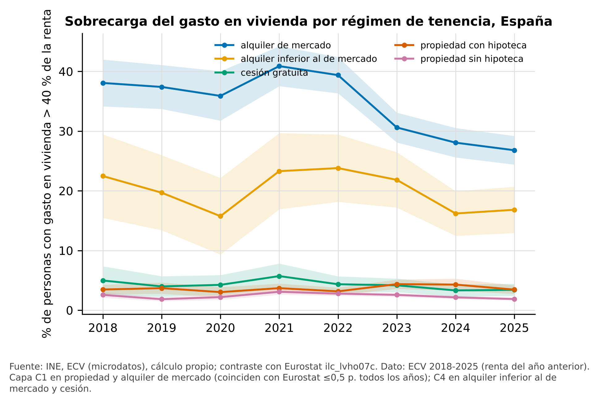{#fig-sobrecarga}

```{python}
#| label: tbl-grupos
#| tbl-cap: "Sobrecarga del 40 % por grupo, último año de la ECV (IC 95 %; capa C4 salvo indicación)."
x = ecv[(ecv.anio == ult) & (ecv.indicador == "sobrecarga_40") & ecv.grupo.isin(["decil_renta", "edad", "nacionalidad"])]
x[["grupo", "categoria", "valor", "ic95_inf", "ic95_sup", "n_muestral", "capa"]].round(1)
```

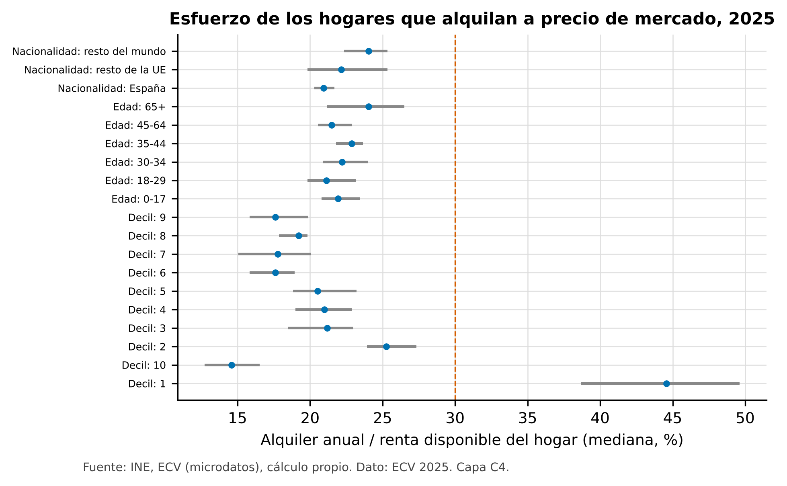{#fig-esfuerzo}

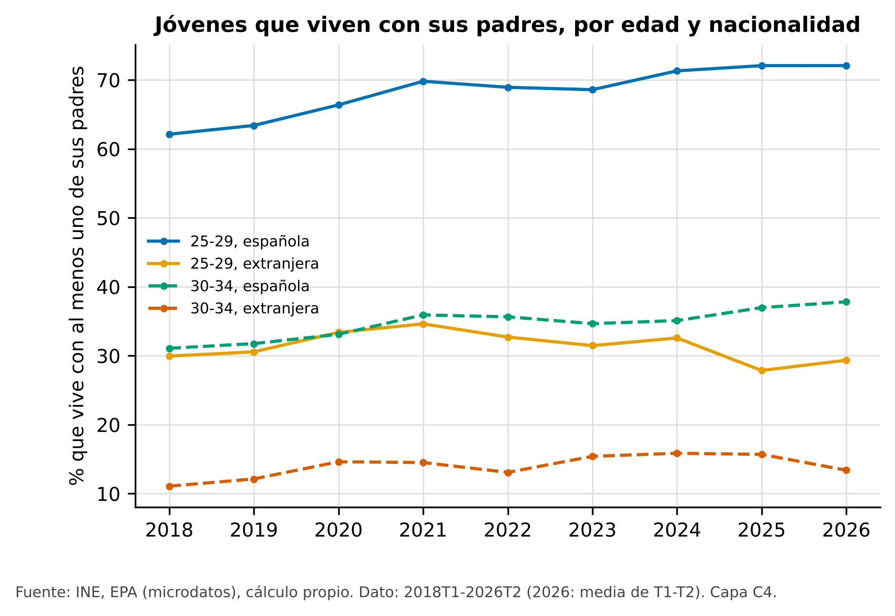{#fig-emancipacion}

### 4.2 Entrar frente a quedarse

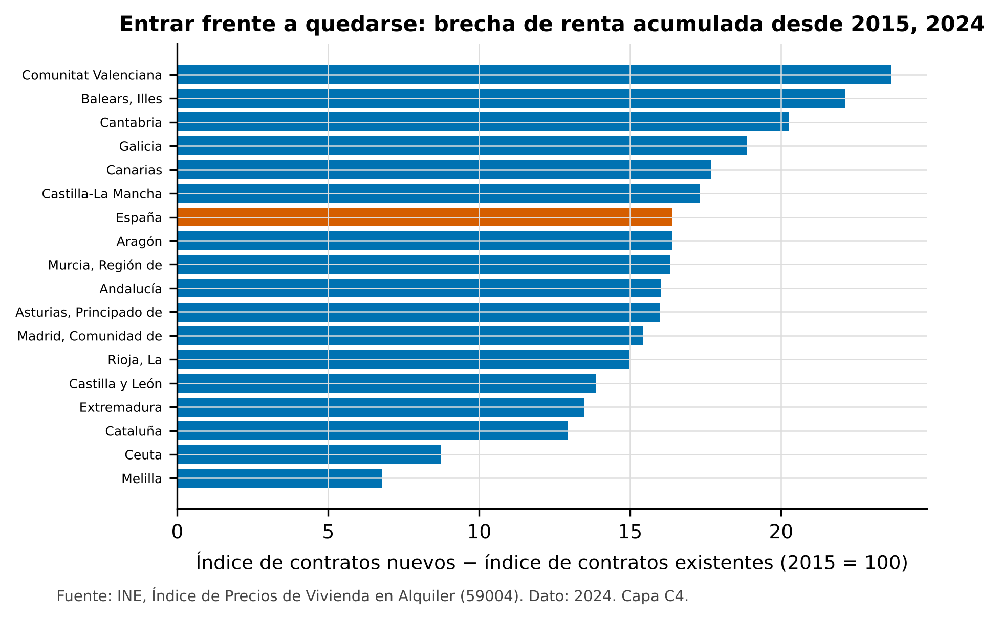{#fig-ipva}

### 4.3 Dónde: provincias, Comunitat Valenciana y València

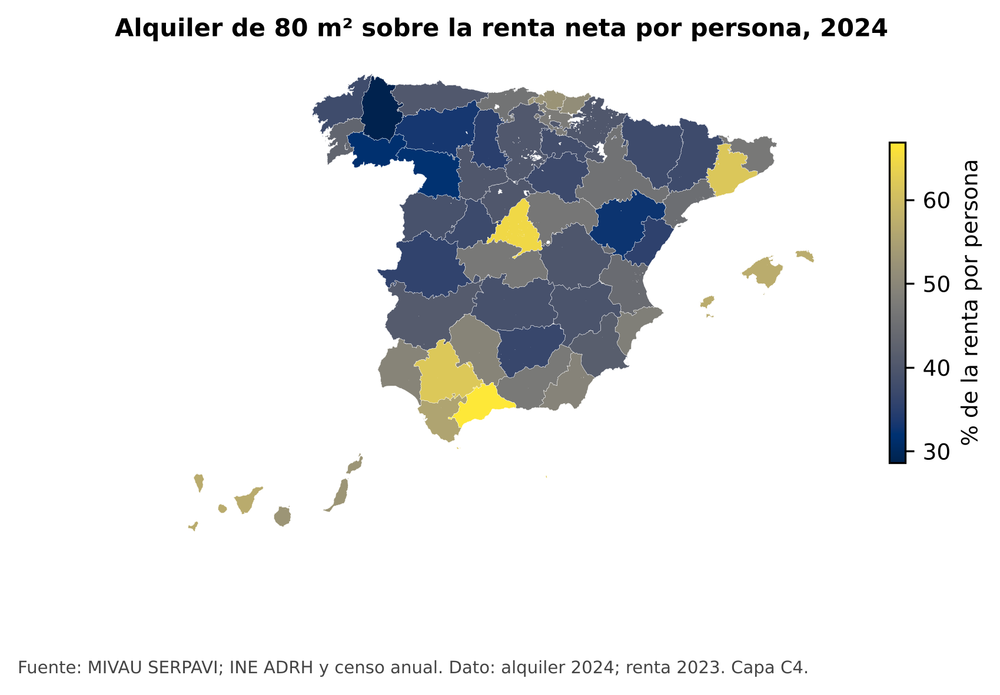{#fig-provincias}

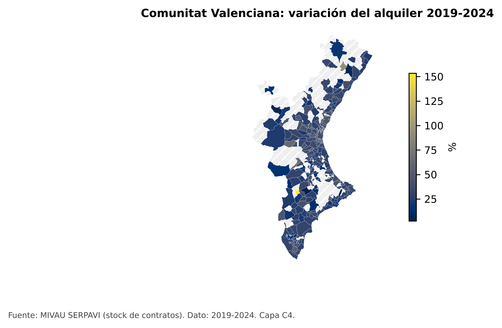{#fig-cv}

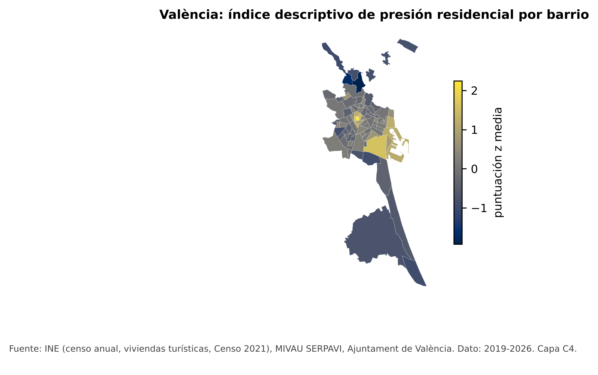{#fig-vlc}

### 4.4 València frente a ciudades comparables

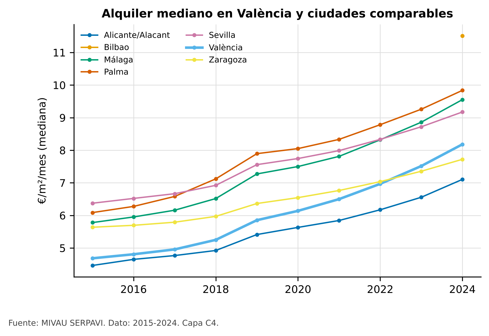{#fig-ciudades}

## 5. Evidencia previa del proyecto (V5-V8), regenerada desde la base

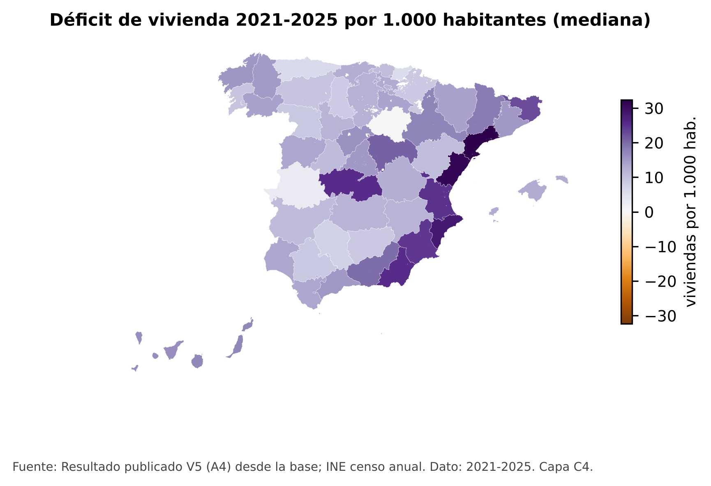{#fig-deficit}

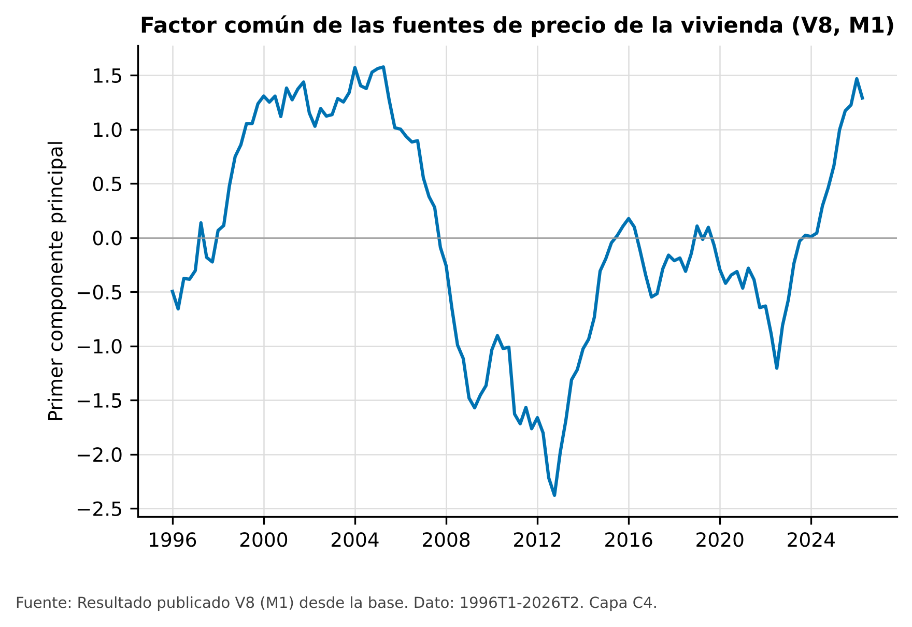{#fig-factor}

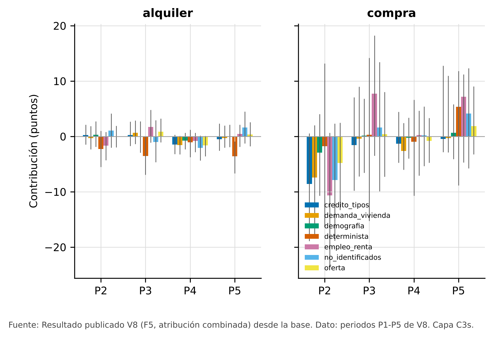{#fig-descomp}

Las conclusiones de V8 se mantienen sin cambios: `publicacion/por_que_ha_subido.md` y el verificador. En particular, ningún factor puede designarse como el más relevante en ninguno de los diez casos analizados (mercado por periodo).

## 6. Diseños causales de v9 [PENDIENTE]

> **Pendiente.** Ninguna de estas secciones tiene resultados. Cada diseño exige su propio pre-registro, la validación por Monte Carlo de sus herramientas, una validación diferida y una revisión independiente (`docs/v9_prep/plan_v9.md`).

### 6.1 Zonas tensionadas: DiD escalonado con Honest DiD [PENDIENTE]

Métodos previstos: @callaway2021 y @rambachan2023. Datos: zonas tensionadas verificadas frente al BOE hasta octubre de 2026 (`data/raw/v9/regulacion`).

### 6.2 Viviendas turísticas en València por sección [PENDIENTE]

Literatura de referencia: @LA05.

### 6.3 Réplica de Sanchis-Guarner con shift-share [PENDIENTE]

Método previsto: @goldsmithpinkham2020 y @borusyak2022.

### 6.4 Bono Alquiler Joven: discontinuidad por edad [PENDIENTE]

Método previsto: @calonico2014.

### 6.5 Reconciliación del déficit [PENDIENTE]

## 7. Discusión y límites

- **Intervalos.** Los de los microdatos son algo estrechos, porque los ficheros públicos no traen el diseño muestral completo.
- **Hacinamiento.** Queda unos 0,8 puntos por debajo de Eurostat todos los años; por eso se mantiene en C4.
- **Datos que faltan:**
  - compraventas municipales con código INE;
  - antigüedad del parque por sección;
  - ediciones históricas de Inside Airbnb.
- **Alcance.** Nada de lo anterior permite atribuir la subida a un único factor.

## Referencias {.unnumbered}

::: {#refs}
:::

## Apéndice A. Replicación {.unnumbered}

| Paso | Orden | Red | Salida |
|---|---|---|---|
| Datos V9 | `make datos_v9` | sí (o verificación sin red) | `data/raw/v9` |
| Geometrías | `python3 src/v10/fetch_geo.py` | sí (una vez) | `data/raw/v10/geo` |
| Base | `make base` | no | `data/base` |
| Atlas | `make atlas` | no | `output/v10/atlas`, `publicacion/atlas_descriptivo.md` |
| Figuras | `make figuras` | no | `figuras/` |
| Web | `make web` | no | `web/_site` |
| Comprobaciones | `make check` | no | tests y controles de texto |

Semilla: 20261010 (no se usa en V10, que no tiene pasos aleatorios). Las muestras selladas (`data/sealed`) no se abren; solo `src/holdout.py` puede leerlas.

## Apéndice B. Uso de IA {.unnumbered}

Véase `DECLARACION_IA.md`.
